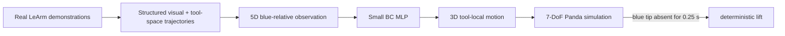

<h1 align="center">Real-Data Cross-Embodiment Manipulation: LeArm → Panda</h1>

<p align="center">
  Humanoid Robot Learning Research challenge submission: a compact visuomotor policy trained from my own physical LeArm demonstrations and deployed on a simulated Franka Panda.
</p>

> **Final-media slot:** before submission, place a short side-by-side real-LeArm / Panda-success GIF or video here. The repository already contains structured real-robot data and example rollout logs; no media is fabricated in this README.

## TL;DR

I collected **24 manipulation demonstrations on a real LeArm** using an eye-in-hand camera and a rod with a blue terminal marker. The task is to align the rod with a red ring, insert it through the opening, and lift the ring.

Rather than retargeting LeArm joint trajectories to Panda joints, I train a small behavior-cloning policy in a **task-centric space**:

- observation: 5 compact visual features describing the red ring relative to the blue tool tip;
- action: 3D tool-local translation over the next 100 ms;
- network: `5 → 64 → 64 → 32 → 3` MLP;
- source data: my own real LeArm demonstrations;
- target embodiment: simulated 7-DoF Franka Panda.

The final controller is intentionally hybrid: the learned policy handles the visually coupled **alignment / approach / insertion** phase; after persistent blue-tip disappearance indicates insertion, a deterministic **lift + mild pitch** primitive completes the task.

This directly satisfies the challenge constraint that personally collected real data must play a role in driving a simulated manipulator, while keeping the implementation small and inspectable.

---

## 1. Challenge idea

The main question I wanted to test was:

> **Can a policy learned from a low-cost real robot transfer to a different robot embodiment if both robots share the same task-centric visual state and tool-space action representation?**

The source and target robots are deliberately different:

| | Real source robot | Simulation target |
| --- | --- | --- |
| Robot | LeArm | Franka Panda |
| Rotary arm DoF | 5 | 7 |
| Observation | eye-in-hand red ring + blue tool tip | equivalent simulated camera observation |
| Learned action | tool-local translation | same tool-local translation |
| Joint mapping | not used | not used |

The transfer therefore happens through **visual/task-space invariants**, not through source joint angles.



---

## 2. Personally collected real data

The repository includes the complete structured logs for **24 physical LeArm episodes**:

```text
24 demonstrations
├── 16 success
└── 8 failure
```

Archive:

```text
real_robot_dataset/learm_demonstrations_structured.zip
```

The original capture also contains raw eye-in-hand video (about **3.27 GB**), which is omitted from this repository because the current policy trains from the synchronized structured logs. The archive contains the task-space reference trajectory, red-ring measurements, blue-tip measurements, timing information, and success/failure metadata.

The data collector and tracker used on the real robot are included under [`real_robot_data_collection/`](real_robot_data_collection/).

The physical LeArm platform and its wider hardware/firmware documentation are maintained in my separate [`ROS2vision`](https://github.com/fBlurryface/ROS2vision) repository. This challenge repo includes only the firmware subset needed to audit the data-collection path.

---

## 3. What the model learns

### Observation

The deployed model uses five visual features:

```text
ring_blue_du_norm
ring_blue_dv_norm
ring_major_ratio
ring_minor_ratio
ring_axis_ratio
```

The important design choice is that the ring position is measured **relative to the detected blue rod tip**, rather than relative to the image center.

This makes the state representation task-centric: the policy sees where the hole is relative to the tool and how the projected ring geometry changes with approach.

### Action

The training target is the tool-local translation observed over the next 100 ms:

```text
[d_left_m, d_up_m, d_forward_m]
```

No LeArm joint angles or teleoperation commands are used as policy targets.

The Panda receives the same canonical tool-space action and resolves it with its own 7-DoF controller.

### Model

```text
5 → 64 → 64 → 32 → 3
    ReLU  ReLU  ReLU
```

The canonical trainer reads the full 24-episode archive, selects successful demonstrations internally, and keeps only pre-insertion windows with real red-ring and blue-tip measurements over the full 100 ms prediction horizon.

That produces **8,252 training samples** from the 16 successful demonstrations.

Training uses normalization, horizontal mirror augmentation, SmoothL1 loss, and larger sample weights for more active motions.

---

## 4. Why the final policy is hybrid

The learned component is used where the task is genuinely visually coupled:

```text
align → approach → insert
```

After insertion, the required behavior is much simpler. The controller therefore switches on a persistent visual event:

```text
blue tip not measured continuously for 0.25 s
                ↓
         insertion event
                ↓
       scripted upward lift
       + mild pitch motion
```

This split is deliberate. I did not keep a learned post-insertion stage simply to make the system "more ML"; the deterministic primitive is easier to inspect and is sufficient for the terminal motion.

---

## 5. Results

### Training-time evaluation

The bundled training report gives grouped held-out validation performance of:

| Metric | Result |
| --- | ---: |
| Mean 3D displacement RMSE | **3.87 mm / 100 ms** |
| Left active-direction accuracy | **92.2%** |
| Up active-direction accuracy | **84.6%** |
| Forward active-direction accuracy | **97.0%** |

These folds are used during model development/model selection, so I treat them as **grouped held-out validation**, not as a pristine final test set.

### Example simulation rollouts

The repository currently includes four hybrid rollout logs in [`results/validated_hybrid_rollouts/`](results/validated_hybrid_rollouts/):

- three reach the post-insertion `SETTLE` state with `phase_pierced=1` and approximately **75–78 mm** of ring lift;
- one randomized-start rollout fails before the insertion transition and remains in `RED_LOST_HOLD`.

This small set is included as an inspectable example, not as a statistically meaningful benchmark. A final submission should pair these logs with a short visual demo and, ideally, an aggregate N-trial success rate.

See [`results/README.md`](results/README.md) for the current artifacts.

---

## 6. What worked / what did not

### What worked

**Task-space transfer instead of joint retargeting.**  The LeArm and Panda have different kinematic structures, but the policy output is embodiment-independent enough for Panda to execute with its own controller.

**Blue-relative visual state.**  Expressing ring location relative to the actual tool-tip marker gave the policy a direct perception-action relationship instead of asking it to infer the tool location from a fixed image reference.

**Learning only the difficult phase.**  The learned policy is responsible for alignment, approach, and insertion; the simple post-insertion motion is handled deterministically. This kept the policy small and the failure modes understandable.

**Using the real trajectory as task-space supervision.**  The source arm has no joint encoders, but the firmware and host collector share the same reference-motion model. I additionally checked the reconstructed task-space motion by replaying recorded poses on Panda.

### What did not / remaining failure modes

**A hand-designed visual servo alone was not a satisfying challenge solution.**  It was a useful baseline and could perform insertion well, but it did not demonstrate direct learned use of the collected demonstrations. The final system therefore keeps the learned pre-insertion controller as the main policy component.

**A fully learned terminal phase was unnecessary.**  Once insertion is detected, the remaining lift is structurally simple; keeping a learned controller there added complexity without a clear benefit for this submission.

**Randomized starts can still leave the learned observation distribution.**  The bundled failed rollout shows a case where the red target is lost before the insertion transition. The runtime includes clipping/OOD hold logic, but broader randomized training data would be the next step for robustness.

---

## 7. Reproduce the pipeline

Install dependencies:

```bash
python -m pip install -r requirements.txt
```

### Check the bundled policy

```bash
python evaluation/check_policy_interface.py
```

### Train a fresh policy from the real dataset

```bash
python behavior_cloning_training/train_blue_relative_pre_insertion_policy.py
```

The trainer reads:

```text
real_robot_dataset/learm_demonstrations_structured.zip
```

and writes directly to:

```text
trained_policy/blue_relative_pre_insertion_policy.npz
```

The simulation uses that same path, so no manual checkpoint copy is needed.

### Smoke-test the Panda simulation

```bash
python evaluation/smoke_test_panda_simulation.py
```

### Run only the learned pre-insertion policy

```bash
python run/run_learned_pre_insertion_policy.py --preset baseline
```

### Run the complete hybrid task

```bash
python run/run_panda_hybrid_ring_pick.py --preset baseline
```

### Replay a recorded real LeArm trajectory on Panda

```bash
python run/replay_real_learm_trajectory_on_panda.py \
  --episode episode_000001 \
  --mode pose
```

---

## 8. Repository layout

```text
learm_firmware/                  challenge-relevant source-robot firmware snapshot
real_robot_data_collection/     real LeArm collection + visual tracking
real_robot_dataset/             complete structured 24-episode dataset
behavior_cloning_training/      canonical BC trainer
trained_policy/                 deployed MLP checkpoint
panda_simulation/               Panda environment, controller, vision and policy runtime
run/                            task entry points
results/                        training metrics and example rollouts
evaluation/                     lightweight interface/simulation checks
docs/technical_appendix.md      implementation details and provenance
```

The three short module READMEs are intentionally focused on reproduction rather than duplicating the project story:

- [`real_robot_dataset/README.md`](real_robot_dataset/README.md)
- [`behavior_cloning_training/README.md`](behavior_cloning_training/README.md)
- [`learm_firmware/README.md`](learm_firmware/README.md)

---

## 9. Important implementation note

The physical LeArm has no actuator position encoders. Its recorded tool pose is therefore a **deterministically reconstructed reference state**, synchronized with the same startup pose, geometry, command semantics, and reference-motion logic as the ESP32 firmware; it is not presented as measured ground-truth joint state.

That distinction, the exact real-data → checkpoint chain, coordinate conventions, and artifact hashes are documented in [`docs/technical_appendix.md`](docs/technical_appendix.md).
