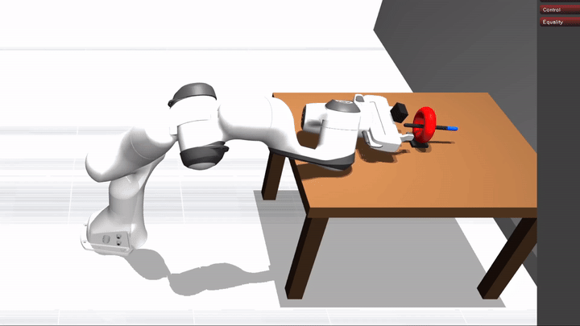
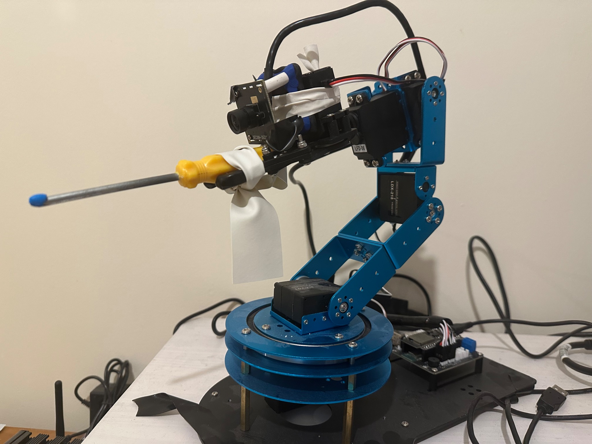
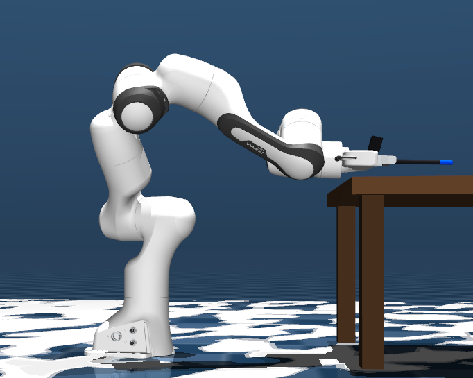
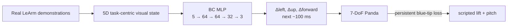
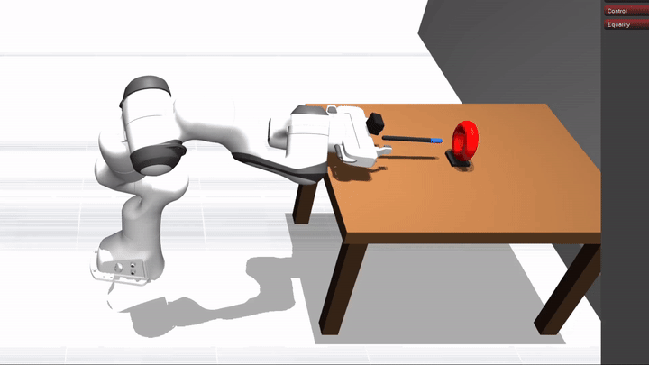

<h1 align="center">Real-to-Sim Visuomotor Transfer: LeArm → Panda</h1>

<p align="center">
  Humanoid Robot Learning Research challenge submission using personally collected real-robot demonstrations to drive a kinematically different manipulator in simulation.
</p>

<p align="center">
  
</p>

<p align="center">
  <strong>Successful final lift in the hybrid policy.</strong><br>
  <a href="results/media/panda_hybrid_full_rollout.mp4">Watch the full 18 s rollout (MP4, 1.5 MB)</a>
</p>

## TL;DR

I collected **24 real LeArm demonstrations** of a rod-in-ring manipulation task and trained a small behavior-cloning policy from the successful trials. The source LeArm has **5 rotary arm DoF + gripper** while the target Franka Panda has **7 rotary arm DoF + gripper**, so I avoid joint retargeting entirely.

Instead, the policy maps a compact **task-centric visual state** to a short-horizon **tool-space motion**. The learned controller performs alignment, approach, and insertion. A persistent blue-tip occlusion event then switches control to a simple scripted lift.

The main design idea is simple: **make the task observable in a representation that is shared by both robots, then learn only the part that transfers cleanly.**

---

## 1. Why this task?

### Transfer behavior, not joints

The source and target manipulators have very different kinematic structures:

| | LeArm | Franka Panda |
| --- | --- | --- |
| Arm structure | approximately `ZYYYZ` | `ZYZYZYZ` |
| Rotary arm DoF | 5 | 7 |
| Gripper | separate actuator | separate actuator |

For the ring-picking task, success depends mainly on the **tool-tip position and rod direction**, not on matching source and target joint angles. Panda's extra redundancy can therefore be used to realize the same task-space behavior with a different joint configuration.

<p align="center">
  
  
</p>
<p align="center"><sub>Real source embodiment (left) and simulated target embodiment (right). The joint structures differ, while the task-relevant tool/camera geometry is preserved.</sub></p>

### Engineer the task for visual observability

I chose an eye-in-hand camera because it gives the operator a natural manipulation view, but conventional close-range grasping creates a problem: as the tool approaches an object, the target can fill or leave the camera view exactly when the most important interaction happens.

I changed the physical task instead of making perception more complicated:

1. attach a thin rod to the LeArm gripper;
2. mount the camera so the rod tip projects near a stable visual reference;
3. use an **upright ring** as the target;
4. add a **blue marker** at the rod tip.

This turns manipulation into a visually simple problem: align the ring opening relative to the tool tip, then move forward along the rod direction.

The blue marker serves two roles:

- while visible, it provides the tool reference used for alignment;
- when the rod passes through the ring, the marker becomes occluded, creating an observable insertion event.

Apparent ring size provides an additional cue for how far the tool has progressed toward the target.

---

## 2. Learned representation

The final policy deliberately uses a small observation and action space.

### Observation: 5 visual quantities

| Signal | Meaning |
| --- | --- |
| ring-tip horizontal offset | lateral correction |
| ring-tip vertical offset | vertical correction |
| major-axis scale | approach progress |
| minor-axis scale | approach progress |
| ellipse axis ratio | current viewing geometry |

Internally these are exported as:

```text
ring_blue_du_norm
ring_blue_dv_norm
ring_major_ratio
ring_minor_ratio
ring_axis_ratio
```

### Action: 3 tool-space quantities

The network predicts $[\Delta L, \Delta U, \Delta F]$, corresponding to **left, up, and forward motion in the tool frame over the next ~100 ms**.


The supervision targets are **not** the LeArm teleoperation commands. They are derived from the recorded tool trajectory over a 5-step horizon (~100 ms), then expressed in the canonical local tool frame. This is what makes the learned action meaningful to both LeArm and Panda.



The complete equations, frame definitions, label construction, and firmware/shadow-state details are in [`docs/technical_appendix.md`](docs/technical_appendix.md).

---

## 3. What worked — and where transfer broke

The experiments exposed a useful boundary between two parts of the task.

| Phase | Dominant factor | Real → sim result |
| --- | --- | --- |
| alignment | visual geometry | transfers well |
| approach | visual geometry / apparent scale | transfers well |
| insertion | visual geometry + blue-tip event | transfers well |
| post-insertion lift | contact dynamics / friction | did not transfer reliably as BC |

The learned policy worked well for the **geometry-dominated** part of the task: alignment, approach, and insertion.

<p align="center">
  
</p>
<p align="center"><sub>Learned pre-insertion phase: alignment → approach → insertion.</sub></p>

The learned lift was less reliable for two reasons. First, my real post-insertion demonstrations were not very consistent: the physical ring often tolerated different lift motions. Second, the real ring was made from high-friction plasticine, while the simulated ring can slide along the rod. The same successful real action therefore does not always produce the same result in simulation.

The final architecture follows that observation rather than forcing the entire task into one learned policy:

```text
learned BC policy
    alignment → approach → insertion
                    ↓
       persistent blue-tip occlusion
                    ↓
scripted terminal primitive
        upward motion + mild pitch
```

**The useful learning boundary emerged between geometry-dominated manipulation and contact-dynamics-dominated manipulation.**

---

## 4. Real data and results

The repository includes the complete structured logs for **24 personally collected physical episodes**:

```text
24 demonstrations
├── 16 success
└── 8 failure
```

The trainer selects successful episodes and valid measured pre-insertion windows internally, producing **8,252 samples**.

### Grouped held-out training evaluation

| Metric | Result |
| --- | ---: |
| 3D displacement RMSE | **3.87 mm / 100 ms** |
| left active-direction accuracy | **92.2%** |
| up active-direction accuracy | **84.6%** |
| forward active-direction accuracy | **97.0%** |

The bundled `results/validated_hybrid_rollouts/` directory contains four inspectable simulation logs: three reach the post-insertion settle state with approximately **75–78 mm** of ring lift, while one randomized-start example fails before insertion after losing the target. These are example rollouts, not a statistically meaningful benchmark.

The original data collection also contains about **3.27 GB of raw eye-in-hand video**. Those videos are omitted from this repository because the current training pipeline uses the synchronized structured logs directly.

---

## 5. Reproduce

Install dependencies:

```bash
python -m pip install -r requirements.txt
```

Train a fresh policy from the bundled real dataset:

```bash
python behavior_cloning_training/train_blue_relative_pre_insertion_policy.py
```

The generated checkpoint is written directly to:

```text
trained_policy/blue_relative_pre_insertion_policy.npz
```

and is the same path consumed by the Panda runtime.

Check the model interface and simulation setup:

```bash
python evaluation/check_policy_interface.py
python evaluation/smoke_test_panda_simulation.py
```

Run the learned phase alone:

```bash
python run/run_learned_pre_insertion_policy.py --preset baseline
```

Run the complete hybrid task:

```bash
python run/run_panda_hybrid_ring_pick.py --preset baseline
```

Replay a recorded real LeArm trajectory on Panda:

```bash
python run/replay_real_learm_trajectory_on_panda.py --episode episode_000001 --mode pose
```

---

## 6. Repository map

```text
real_robot_data_collection/   real LeArm recorder + visual tracker
real_robot_dataset/           24 structured physical demonstrations
behavior_cloning_training/    canonical trainer
trained_policy/               deployed MLP checkpoint
panda_simulation/             Panda environment, vision and controller
run/                          main rollout / replay entry points
evaluation/                   interface and simulation smoke tests
results/                      metrics + rollout logs + submission media
learm_firmware/               challenge-relevant ESP32 firmware snapshot
docs/technical_appendix.md    exact technical definitions and provenance
```

The wider LeArm hardware/firmware project is documented separately in [`fBlurryface/ROS2vision`](https://github.com/fBlurryface/ROS2vision).
