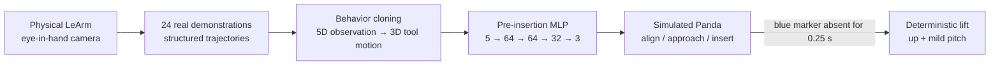

<h1 align="center">Real LeArm → Panda Visual Imitation</h1>

<p align="center">
  Cross-embodiment robot learning from personally collected physical LeArm demonstrations to a simulated Franka Panda.
</p>

This repository is the challenge-specific pipeline used to collect real manipulation demonstrations, train a compact behavior-cloning policy, and deploy that policy on a different robot embodiment in MuJoCo.

The task is deliberately simple to describe but sensitive to perception and tool geometry: an eye-in-hand camera observes a red ring and a blue marker at the end of a rod; the robot must align the rod with the ring, insert it through the opening, and then lift the ring.

The final system is **hybrid**:

| Phase | Controller | Learned from real data? |
| --- | --- | --- |
| Alignment + approach + insertion | 5D visual observation → small MLP → tool-local translation | **Yes** |
| Insertion event | sustained loss of the blue terminal marker | No — deterministic event logic |
| Lift | upward translation + mild pitch motion | No — deterministic terminal primitive |

The learned component therefore handles the visually coupled part of the task; the simple post-insertion motion is intentionally scripted rather than represented as an end-to-end learned policy.

---

## System overview



The transfer is performed in **task space**, not by copying LeArm joint motion onto Panda. The learned action is a local Cartesian displacement over 100 ms:

```text
[d_left, d_up, d_forward]
```

Panda resolves that command with its own 7-DoF controller. No LeArm or Panda joint angles are inputs to the learned policy.

---

## Source robot: LeArm and ROS2vision

The physical source robot is a LeArm controlled by an ESP32. The broader LeArm platform, complete ESP-IDF project, hardware notes, calibration records, and ROS 2 work are maintained in the separate **[ROS2vision](https://github.com/fBlurryface/ROS2vision)** repository.

ROS2vision documents the arm controller as five rotary joints plus an independent claw, with USB-serial command access, position/streaming-velocity reference control, and resolved-rate kinematics. It also explicitly records that the arm has **no actuator position feedback**: reported joint/FK state is a software reference rather than an encoder measurement.

Useful platform references:

- [ROS2vision overview](https://github.com/fBlurryface/ROS2vision)
- [LeArm hardware, calibration, geometry and startup pose](https://github.com/fBlurryface/ROS2vision/blob/main/docs/hardware.md#arm-hardware-and-calibration)
- [ESP32 arm architecture and controller boundaries](https://github.com/fBlurryface/ROS2vision/blob/main/docs/architecture.md#esp32-arm-controller)
- [ESP32 arm commands and state semantics](https://github.com/fBlurryface/ROS2vision/blob/main/docs/interfaces.md#esp32-arm-serial-protocol)

This challenge repository does **not** require the ROS 2 arm integration planned in ROS2vision. Demonstration collection uses the existing ESP32 USB-serial control path directly. A compact snapshot of the challenge-relevant firmware is included under [`learm_firmware/`](learm_firmware/).

### Reference-state reconstruction

Because the physical arm has no joint encoders, [`collect_learm_demonstrations.py`](real_robot_data_collection/collect_learm_demonstrations.py) maintains a host-side `ShadowLeArm` reference state synchronized with the same startup pose, geometry, command semantics, motion limits, and reference-motion logic used by the firmware.

The relevant source-robot model is:

| Quantity | Value |
| --- | ---: |
| Base-to-shoulder vertical offset | 28.9 mm |
| Upper arm | 104.3 mm |
| Forearm | 89.0 mm |
| Wrist-to-tool reference point | 177.0 mm |
| Startup rotary reference | `[0, -60, 70, 70, 0]°` |

The recorded task-space trajectory is therefore a **deterministically reconstructed reference trajectory**, not encoder-measured state. For this project, those task-space trajectories were additionally checked by replaying them on Panda and comparing the resulting manipulation motion with the original physical demonstrations. See [`docs/firmware_shadow_model_mapping.md`](docs/firmware_shadow_model_mapping.md).

---

## Real-robot data

The repository includes the complete structured logs for all **24 physical demonstrations**:

```text
24 episodes
├── 16 success
└── 8 failure
```

Dataset:

```text
real_robot_dataset/learm_demonstrations_structured.zip
```

Each episode records the robot reference trajectory, task-space tool pose, red-ring measurements, blue-tip measurements, timing information, and phase/event fields produced during collection.

The full raw eye-in-hand video archive is approximately **3.27 GB** and is intentionally not bundled because the current policy trains directly from the structured logs. See [`real_robot_dataset/README.md`](real_robot_dataset/README.md).

### Compact visual observation

The learned policy uses only five task-centric visual features:

| Feature | Meaning |
| --- | --- |
| `ring_blue_du_norm` | horizontal ring-center displacement relative to the measured blue tip |
| `ring_blue_dv_norm` | vertical ring-center displacement relative to the measured blue tip |
| `ring_major_ratio` | current ring major axis / first valid major axis |
| `ring_minor_ratio` | current ring minor axis / first valid minor axis |
| `ring_axis_ratio` | ring minor axis / major axis |

The key representation choice is that image error is measured **relative to the blue terminal marker**, not relative to the image center.

---

## Behavior-cloning policy

Canonical trainer:

```text
behavior_cloning_training/train_blue_relative_pre_insertion_policy.py
```

The trainer reads the complete 24-episode archive and performs all filtering internally. Only successful demonstrations are used for the deployed policy, and a 100 ms training window is retained only when the complete horizon has:

- a real red-ring measurement,
- a real blue-tip measurement,
- `pierced == 0`.

This produces **8,252 valid pre-insertion samples** from the 16 successful episodes.

### Action target

For each valid time step, the target is the observed tool-local translation over the next 100 ms:

```text
[d_left_m, d_up_m, d_forward_m]
```

The target comes from successive reconstructed task-space poses, not from the source robot's joint commands or teleoperation inputs.

### Network and optimization

```text
5 → 64 → 64 → 32 → 3
    ReLU  ReLU  ReLU
```

Training uses:

- observation/action normalization stored inside the exported `.npz`,
- SmoothL1 loss,
- larger loss weight for more active motion samples,
- horizontal mirror augmentation,
- episode-grouped validation.

The bundled training report records a mean grouped validation vector RMSE of approximately **3.87 mm per 100 ms**. These folds are used for training-time model selection and should be interpreted as grouped held-out validation rather than a separately untouched final test set.

More detail is in [`behavior_cloning_training/README.md`](behavior_cloning_training/README.md) and [`results/training_metrics.json`](results/training_metrics.json).

---

## Panda deployment

The exported policy is:

```text
trained_policy/blue_relative_pre_insertion_policy.npz
```

The artifact contains:

- MLP weights and biases,
- observation mean/std,
- action mean/std,
- feature names,
- action names,
- 100 ms policy horizon metadata.

At runtime, the MLP controls only translation in the canonical tool frame. The Panda controller converts that task-space command to its own 7-DoF joint motion. Deployment also applies task-speed clipping and an out-of-distribution hold around the learned policy.

When the blue marker has been continuously unmeasured for **0.25 s**, control switches to the terminal primitive. The default full-task runtime then commands approximately:

- `+80 mm/s` upward translation,
- `-8 deg/s` pitch rate,
- for `1.5 s`, followed by a short settle period.

The final hybrid entry point is [`run/run_panda_hybrid_ring_pick.py`](run/run_panda_hybrid_ring_pick.py).

---

## Quick start

Python 3.10+ is recommended.

### 1. Install dependencies

```bash
python -m pip install -r requirements.txt
```

### 2. Check the bundled policy interface

```bash
python evaluation/check_policy_interface.py
```

### 3. Retrain from the bundled real dataset

```bash
python behavior_cloning_training/train_blue_relative_pre_insertion_policy.py
```

The trainer reads:

```text
real_robot_dataset/learm_demonstrations_structured.zip
```

and writes directly to:

```text
trained_policy/blue_relative_pre_insertion_policy.npz
```

The simulation uses that same path by default, so no manual checkpoint copy is required.

Run the contract check again after retraining:

```bash
python evaluation/check_policy_interface.py
```

### 4. Smoke-test the Panda simulation

```bash
python evaluation/smoke_test_panda_simulation.py
```

### 5. Run only the learned phase

```bash
python run/run_learned_pre_insertion_policy.py --preset baseline
```

Randomized ring placement:

```bash
python run/run_learned_pre_insertion_policy.py --preset random --seed 1
```

### 6. Run the complete hybrid task

```bash
python run/run_panda_hybrid_ring_pick.py --preset baseline
```

### 7. Replay a real LeArm trajectory on Panda

```bash
python run/replay_real_learm_trajectory_on_panda.py \
    --episode episode_000001 \
    --mode pose
```

### Clean retraining check

To verify the complete data → model → Panda path without relying on the bundled reference policy:

```text
1. delete trained_policy/blue_relative_pre_insertion_policy.npz
2. run the canonical trainer
3. confirm the policy file is recreated
4. run evaluation/check_policy_interface.py
5. run the Panda policy
```

---

## Repository layout

```text
learm-to-panda-visual-imitation/
├── learm_firmware/                 challenge-relevant LeArm firmware snapshot
├── real_robot_data_collection/     physical teleoperation, perception and recording
├── real_robot_dataset/             complete 24-episode structured dataset
├── behavior_cloning_training/      single canonical BC trainer
├── trained_policy/                 deployed pre-insertion policy
├── panda_simulation/               Panda environment, vision and control modules
├── run/                            runnable learned/hybrid/replay entry points
├── evaluation/                     policy-contract and simulation smoke checks
├── results/                        training metrics and validated rollout logs
└── docs/                           method, provenance and validation notes
```

The intended provenance chain is deliberately one-to-one:

```text
real_robot_dataset/learm_demonstrations_structured.zip
        ↓
behavior_cloning_training/train_blue_relative_pre_insertion_policy.py
        ↓
trained_policy/blue_relative_pre_insertion_policy.npz
        ↓
run/run_panda_hybrid_ring_pick.py
```

---

## Reproducibility and scope

- The bundled `.npz` is the reference policy used by the validated simulation build.
- Running the canonical trainer overwrites that path with the newly trained policy.
- Fixed seeds make data construction and evaluation repeatable, but bitwise-identical learned weights are **not** claimed across different PyTorch/CPU numerical environments.
- The structured dataset contains all 24 collected episodes; the raw video archive is omitted only for repository size.
- LeArm state is reconstructed from the firmware reference model rather than measured by joint encoders.
- The deployed system is explicitly **hybrid**, not an end-to-end learned full-task policy.
- The ROS 2 arm integration discussed in ROS2vision is outside the scope of this challenge repository; this project uses the existing ESP32 USB-serial control path for real data collection.

See [`docs/data_and_policy_provenance.md`](docs/data_and_policy_provenance.md) and [`docs/validation_notes.md`](docs/validation_notes.md) for the exact artifact chain and validation boundaries.
